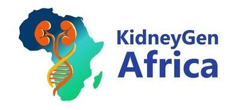

  

# KidneyGenAfrica Malawi Workshop 2027

🧬 [Wellcome Sanger Institute](https://www.sanger.ac.uk/)  
🧑‍💻 [Scientific Training and Events Website](https://coursesandconferences.wellcomeconnectingscience.org/)
🧬 [KidneyGen Website](https://www.kidneygenafrica.org/opportunities/malawi-workshop)

### Overview

Kidney disease is a major and growing health challenge across Africa, yet African populations remain vastly underrepresented in genetic studies of chronic kidney disease (CKD). Harnessing Africa’s unparalleled genomic diversity to understand kidney disease risk and improve patient outcomes requires both cutting-edge science and a new generation of African leaders in kidney genomics.

Following the success of our inaugural KidneyGenAfrica short course in January 2026, we are hosting another five day intensive workshop in Malawi. This workshop will bring together a diverse group of postgraduate and early-career researchers from across the continent to strengthen knowledge, practical skills, and collaborative networks in the genetic epidemiology of kidney disease. Participants will learn the foundations of bioinformatics, gain hands-on experience running GWAS and using PLINK, and explore kidney disease phenotypes, and evaluate shared genetic architecture between kidney function and related complex traits.

Through expert-led seminars, interactive discussions, and practical data analysis sessions, the course will provide a platform to examine ethical and community considerations in African genomics, share research across diverse contexts, and develop project proposals. Participants will leave with new technical skills, strengthened professional networks, and a deeper understanding of how to drive equitable kidney genomics research across Africa.

### Learning outcomes

By the end of the course, the participants will be able to:

- Describe key kidney disease phenotypes, how they are clinically measured, and the genetic factors that contribute to disease risk across diverse African populations.
- Perform a GWAS pipeline and critically interpret findings in the context of African genomic diversity.
- Evaluate the shared genetic architecture of complex traits using genetic correlation and colocalisation approaches.
- Select appropriate methods, tools, and datasets to develop a feasible strategy for addressing a given research question.

### Programme Details

Workshop dates: **24th to 29th January 2027**
Co-hosted by: Malawi Epidemiology and Intervention Research Unit and Kamuzu University of Health Sciences
Venue: Kamuzu University of Health Sciences, Lilongwe Campus, Malawi

#### Citing and Re-using Course Material

> The course data are free to reuse and adapt with appropriate attribution. All course data in these repositories are licensed under the <a rel="license" href="https://creativecommons.org/licenses/by-nc-sa/4.0/">Attribution-NonCommercial-ShareAlike 4.0 International (CC BY-NC-SA 4.0)</a>.   

> Each course landing page is assigned a DOI via Zenodo, providing a stable and citable reference. These DOIs can be found on the respective course landing pages and can be included in CVs or research publications, offering a professional record of the course contributions.

#### Discover more about us and take the next step by applying for a course.

- 🧬 [Wellcome Sanger Institute](https://www.sanger.ac.uk/)
- 🧑‍💻 [Scientific Training and Events Website](https://coursesandconferences.wellcomeconnectingscience.org/)

________
